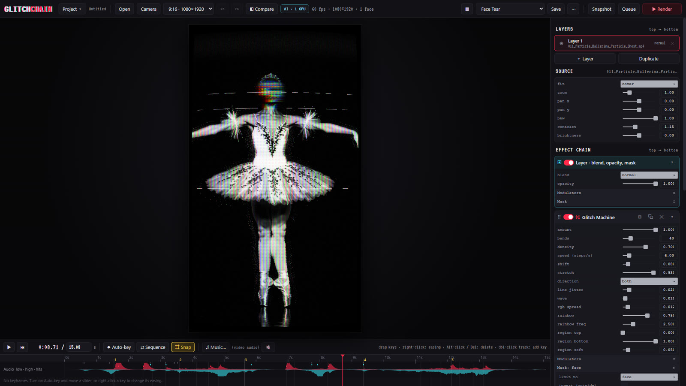
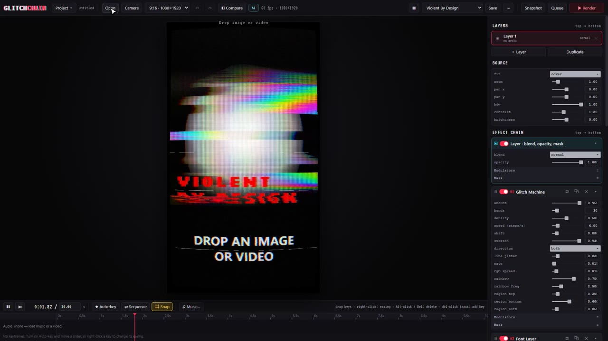
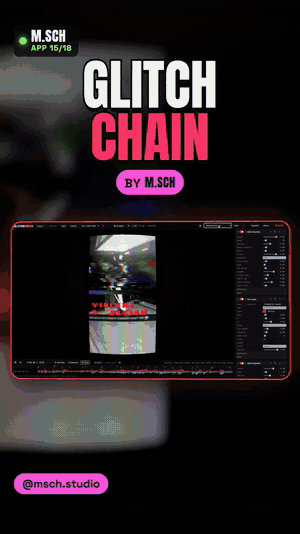
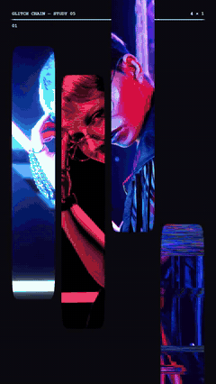
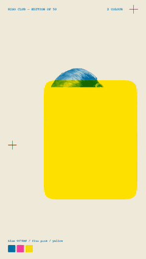
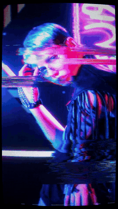
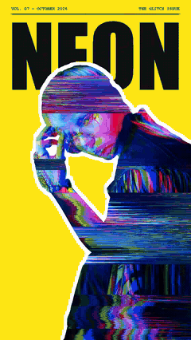
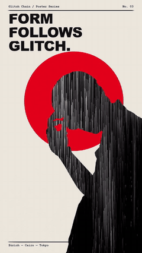
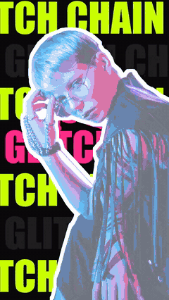

# Glitch Chain

A real-time analog glitch studio for photos, videos and your webcam. Stack stretch-tears, tape rot, RGB split, pixel
sorting, datamosh and CRT, mask any effect to a face, a person, hands or any object with AI, sync it all to the beat
of your music, and render a frame-exact MP4 or ProRes file. Everything, including the AI, runs on your own computer.

A desktop app built with Electron, TypeScript and raw WebGL2.



<!-- videos:start -->
## See it in action

<table><tr>
<td width="64%" valign="top"><a href="docs/videos/tutorial.mp4"></a><br><b>▶ <a href="docs/videos/tutorial.mp4">Full tutorial</a></b> (2:39, narrated, with captions)</td>
<td width="36%" valign="top" align="center"><a href="docs/videos/ad.mp4"></a><br><b>▶ <a href="docs/videos/ad.mp4">25-second reel</a></b></td>
</tr></table>

**Made with Glitch Chain: one portrait, six looks**

<table><tr>
<td width="33%" align="center"><a href="docs/videos/examples/fragments.mp4"></a><br><a href="docs/videos/examples/fragments.mp4">Fragments</a></td>
<td width="33%" align="center"><a href="docs/videos/examples/riso-print.mp4"></a><br><a href="docs/videos/examples/riso-print.mp4">Riso Print</a></td>
<td width="33%" align="center"><a href="docs/videos/examples/neon-bleed.mp4"></a><br><a href="docs/videos/examples/neon-bleed.mp4">Neon Bleed</a></td>
</tr><tr>
<td width="33%" align="center"><a href="docs/videos/examples/cover-story.mp4"></a><br><a href="docs/videos/examples/cover-story.mp4">Cover Story</a></td>
<td width="33%" align="center"><a href="docs/videos/examples/swiss-poster.mp4"></a><br><a href="docs/videos/examples/swiss-poster.mp4">Swiss Poster</a></td>
<td width="33%" align="center"><a href="docs/videos/examples/type-marquee.mp4"></a><br><a href="docs/videos/examples/type-marquee.mp4">Type Marquee</a></td>
</tr></table>

Click any picture to play the video with sound.
<!-- videos:end -->

## What it does

- **Looks**: 28 complete presets (Beat Tear, Face Tear, Datamosh Melt, Pixel Sort Drip, Feedback Tunnel, Neon Noir...).
  Pick one and the whole effect chain is rebuilt, then tweak it.
- **The chain**: effects run top to bottom: glitch machine (stretch and tear in bands), font layer (retro type),
  tape rot, RGB split, CRT, block crush, datamosh, pixel sort, warp, glow, punch-in, depth of field. Toggle, duplicate,
  remove or randomize any effect.
- **Masks**: limit any effect with AI: face, person, body parts, hands, pose, or any object you type ("car", "cup"),
  or click the object (SAM). Or key a colour, pick a depth range, or draw the mask yourself.
- **Modulators**: animate any parameter with an LFO or with the music's bass, mids or highs.
- **Layers**: several clips, each with its own blend mode, opacity and mask. Finish with a LUT and film grain.
- **Timeline**: auto-key turns every change into a keyframe. Load music and Glitch Chain finds its beats and bars;
  snap locks keys to the beat. Sequence lines up clips back to back.
- **Output**: vertical 9:16, 4:5, square or wide. PNG snapshots, frame-exact MP4 or ProRes with audio, and a render
  queue. Projects save as `.glitch` files with their masks inside. Live webcam input. Undo covers everything.

## Run

You need [Node.js](https://nodejs.org) 22 or newer.

```bash
git clone https://github.com/mariobilly/glitch-chain.git
cd glitch-chain
npm install        # also fetches the AI models (about 450 MB, once)
npm run dev        # start the app with live reload
```

Build a Windows app (installer and portable `.exe` in `dist\`):

```bash
npm run build:win
```

Made and tested on Windows 11. The code isn't Windows-specific, but macOS and Linux haven't been tried.

### The AI models

`npm install` runs `scripts/get-models.mjs`, which downloads these files into the app, checks each one's SHA-256 and
never downloads them again. After that, the app works offline: it never contacts Hugging Face or a CDN.
If the download is interrupted, run `npm run models`.

| Model | Used for | Source | Licence |
|---|---|---|---|
| Segment Anything (SAM ViT-B) | masks from a click | [Xenova/sam-vit-base](https://huggingface.co/Xenova/sam-vit-base) | Apache-2.0 |
| Grounding DINO tiny | masks from typed words | [onnx-community/grounding-dino-tiny-ONNX](https://huggingface.co/onnx-community/grounding-dino-tiny-ONNX) | Apache-2.0 |
| Depth Anything V2 Small | depth masks, depth of field, 2.5D parallax | [onnx-community/depth-anything-v2-small](https://huggingface.co/onnx-community/depth-anything-v2-small) | Apache-2.0 |
| MediaPipe face, selfie, multiclass, hand, pose, EfficientDet | live face / person / hand / object tracking | [MediaPipe models](https://ai.google.dev/edge/mediapipe/solutions/guide) | Apache-2.0 |

## Shortcuts

| Key | Action |
|---|---|
| Space | Play / pause |
| Home | Back to the start |
| `[` `]` | Previous / next beat |
| K | Auto-key on / off |
| B (hold) | Show the original |
| Ctrl+Z / Ctrl+Y | Undo / redo |
| Ctrl+O | Open media |
| Ctrl+Shift+O | Open a project |
| Ctrl+S / Ctrl+Shift+S | Save / save as |
| Ctrl+N | New project |
| Ctrl+R | Render |

You can also drag photos, videos, music and saved presets straight onto the window. The Finish effect takes any 3D
`.cube` LUT.

## Tests

The end-to-end tests drive the built app with Puppeteer: `npm run build`, then for example `node tests/ui.e2e.mjs`.
Some tests take a test image or video from an environment variable; the first lines of each test file say which.

## Licence

MIT, see [LICENSE](LICENSE). The AI models keep their own licences (table above).
